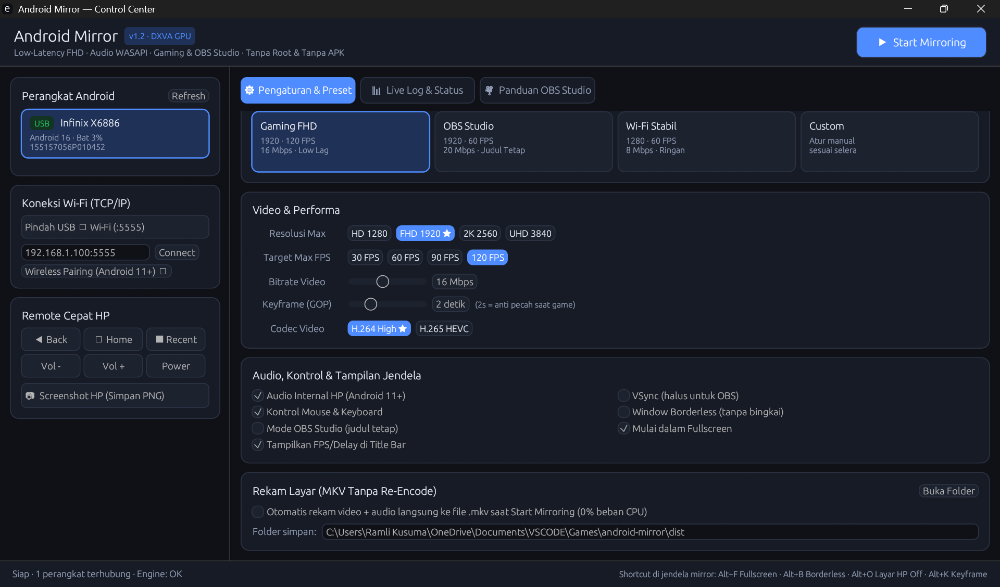

  

📱 AndroidMirror

-0078D6?style=for-the-badge&logo=windows)
-3DDC84?style=for-the-badge&logo=android&logoColor=white)

**AndroidMirror** adalah aplikasi desktop Windows ultra-ringan untuk melakukan **mirroring layar dan audio perangkat Android ke laptop/PC** melalui **USB** maupun **Wi-Fi (TCP/IP)** dengan kontrol penuh **keyboard & mouse** — **tanpa root** dan **tanpa menginstal aplikasi (APK)** di perangkat Android.

Dirancang khusus untuk **latensi sangat rendah**, **gameplay mulus (FHD 30–120 FPS)**, **audio jernih**, serta **dukungan penuh OBS Studio** untuk kebutuhan live streaming dan perekaman konten.

---

## ✨ Fitur Utama

- **🔒 Tanpa Root & Tanpa Install APK**
  Tidak memasang aplikasi apa pun di HP. Cukup aktifkan *USB Debugging*, server sementara (~22 KB) berjalan otomatis saat terhubung dan berhenti bersih saat aplikasi ditutup.
- **⚡ Latensi Sangat Rendah & Stabil (Mode USB Real-Time)**
  Menggunakan pipeline antrian maksimal 1 frame (*latest-frame-wins*), `TCP_NODELAY`, dan watchdog otomatis agar delay tidak pernah menumpuk meski dipakai berjam-jam.
- **🎮 Full HD Optimal (30–120 FPS) & Anti Pecah-Pecah Saat Main Game**
  Mendukung hardware encoding **H.264 High Profile** / **H.265 (HEVC)** dengan **VBR**, **GOP 2 detik**, dan standar warna **BT.709** sehingga adegan game cepat tetap tajam dan halus.
- **🚀 Super Ringan di CPU (Hardware DXVA GPU Decode)**
  Decoding dan rendering berjalan langsung di GPU (*Direct3D 11 + Zero-Copy DXVA*), sangat ringan di CPU dan RAM (~4 MB aplikasi utama, tanpa browser/Electron).
- **🔊 Audio Internal Jernih (Android 11+)**
  Menangkap audio internal HP (48 kHz stereo PCM) dengan *WASAPI Adaptive Resampler* dan *jitter buffer* untuk mencegah suara kresek, putus-putus, maupun delay audio yang menumpuk.
- **🖱️ Kontrol Keyboard & Mouse Lengkap**
  Kendalikan HP langsung dari laptop: sentuh, drag, scroll, ketik teks, tombol navigasi, remote cepat HP, hingga **Screenshot PNG 1-klik**.
- **🎥 Siap Streaming di OBS Studio**
  Mode khusus **OBS Studio** dengan judul jendela statis (`amirror [OBS]`), penyesuaian rasio otomatis saat HP berputar **Portrait ↔ Landscape** (tanpa bar hitam), warna Rec. 709, Borderless (`Alt+B`), ukuran 1:1 native (`Alt+1`), serta dukungan audio game terpisah via *Application Audio Capture*.
- **⏺️ Rekam Layar Tanpa Re-Encode (`.mkv`)**
  Rekam langsung video & audio ke file `.mkv` tanpa membebani CPU/GPU.
- **📡 Koneksi USB & Wi-Fi (TCP/IP)**
  Mendukung mirroring via kabel USB, pindah cepat USB → Wi-Fi (`:5555`), koneksi `IP:Port`, dan **Wireless Debugging Pairing** (Android 11+).
- **🖥️ Control Center Modern (Dark Mode)**
  Tampilan desktop ringan dengan deteksi HP otomatis (model, versi Android, persentase baterai), 4 preset 1-klik (*Gaming FHD*, *OBS Studio*, *Wi-Fi Stabil*, *Custom*), dan *Live Log*.

---

## 📥 Unduh Aplikasi

Unduh versi terbaru pada halaman **[Releases](https://github.com/kramli436-tech/AndroidMirror/releases/latest)**:

👉 **[Download AndroidMirror (Windows 64-bit)](https://github.com/kramli436-tech/AndroidMirror/releases/latest)**

---

## 💻 Persyaratan Sistem

| Komponen | Minimum / Rekomendasi |
|---|---|
| **OS Laptop / PC** | Windows 10 / Windows 11 (64-bit) dengan GPU Direct3D 11 |
| **Android (Video & Kontrol)** | Android 8.0 ke atas dengan **USB Debugging** aktif |
| **Android (Audio Internal)** | Android 11 ke atas *(Android 12+ langsung jalan; Android 11 layar harus dalam kondisi tidak terkunci saat mulai; Android ≤ 10 otomatis video saja)* |
| **Kabel / Jaringan** | Kabel USB data berkualitas baik (disarankan untuk latensi terendah) atau Wi-Fi 5 GHz |

---

## 🚀 Cara Penggunaan

1. **Aktifkan USB Debugging di HP Android:**
   - Buka *Settings → About Phone* → ketuk *Build Number* 7× untuk mengaktifkan *Developer Options*.
   - Buka *Developer Options* → aktifkan **USB Debugging**.
   - *(Khusus Xiaomi / MIUI / HyperOS: aktifkan juga **USB debugging (Security settings)** agar kontrol mouse & keyboard berfungsi).*
2. **Ekstrak** file ZIP yang diunduh dari halaman **Releases** ke satu folder.
3. **Colokkan HP ke laptop** lewat kabel USB, lalu pilih **Allow / Izinkan** pada popup *USB Debugging* di layar HP.
4. **Jalankan `AndroidMirror.exe`** (double-click).
5. Pilih perangkat Android Anda, pilih preset (**Gaming FHD** / **OBS Studio** / **Wi-Fi Stabil**), lalu klik **Start Mirroring**.

---

## 🎥 Panduan Setup OBS Studio

1. Di `AndroidMirror.exe`, pilih preset **OBS Studio**, lalu klik **Start Mirroring** (jendela otomatis berjudul **`amirror [OBS]`**).
2. **Tambah Video di OBS Studio:**
   - Klik **Sources → `+` → Window Capture**.
   - **Window:** `[amirror.exe]: amirror [OBS]`
   - **Capture Method:** `Windows 10 (1903 and up)`
   - Centang **Client Area**, lalu tekan **`Ctrl + F`** (*Fit to Screen*).
3. **Tambah Audio Game Terpisah (tanpa suara Discord/PC):**
   - Klik **Sources → `+` → Application Audio Capture (BETA)**.
   - Pilih `[amirror.exe]: amirror [OBS]`.
4. **Rekomendasi Setting OBS:**
   - *Settings → Video*: **1920×1080 @ 60 fps**, Downscale Filter **Lanczos**.
   - *Settings → Advanced*: Color Space **Rec. 709**.
   - Saat game dibuka dalam mode *Landscape*, jendela `amirror` otomatis menyesuaikan rasio tanpa bar hitam.

---

## ⌨️ Kontrol & Shortcut

| Input / Shortcut | Fungsi |
|---|---|
| `Klik kiri / drag` | Sentuh & geser layar HP |
| `Klik kanan` | Tombol **Back** (atau menyalakan layar jika mati) |
| `Klik tengah` / `Alt + H` | Tombol **Home** |
| `Scroll wheel` | Scroll layar |
| `Alt + F` | Toggle **Fullscreen** |
| `Alt + B` | Toggle **Borderless** (tanpa bingkai, cocok untuk OBS) |
| `Alt + 1` / `Alt + 2` | Ukuran jendela **1:1 Native** / pas layar desktop |
| `Alt + O` | Matikan / nyalakan layar fisik HP (mirror tetap aktif) |
| `Alt + R` | Putar orientasi layar (**Rotate**) |
| `Alt + K` | Paksa kirim keyframe baru (refresh ketajaman instan) |
| `Alt + I` | Tampilkan / sembunyikan info FPS & delay di title bar |
| `Alt + S` | Recent Apps |
| `Alt + ↑` / `Alt + ↓` | Volume Naik / Turun |
| `Alt + P` | Tombol Power |

---

## ❓ Pertanyaan Umum & Batasan

- **Mengapa layar aplikasi tertentu (Netflix / m-Banking) tampil hitam?**
  Aplikasi dengan proteksi DRM / `FLAG_SECURE` memang diblokir oleh sistem Android untuk keamanan dan tidak dapat direkam tanpa root.
- **Apakah aman untuk HP?**
  Aman. Tidak ada perubahan sistem, tidak butuh root, dan tidak ada aplikasi permanen yang terpasang di HP.
- **Apakah bisa dipakai sambil main game 120 FPS?**
  Bisa, selama layar dan hardware encoder HP mendukung 90/120 Hz. Untuk kelancaran terbaik tanpa patah-patah, gunakan preset **Gaming FHD (1920)** melalui kabel USB.
- **Bagaimana cara pakai lewat Wi-Fi tanpa kabel?**
 Dalam proses perkembangan

---

## 📄 Catatan Rilis & Masalah (Issues)

- Unduh rilis terbaru: **[Releases](https://github.com/kramli436-tech/AndroidMirror/releases)**
- Laporkan bug atau saran fitur: **[Issues](https://github.com/kramli436-tech/AndroidMirror/issues)**
